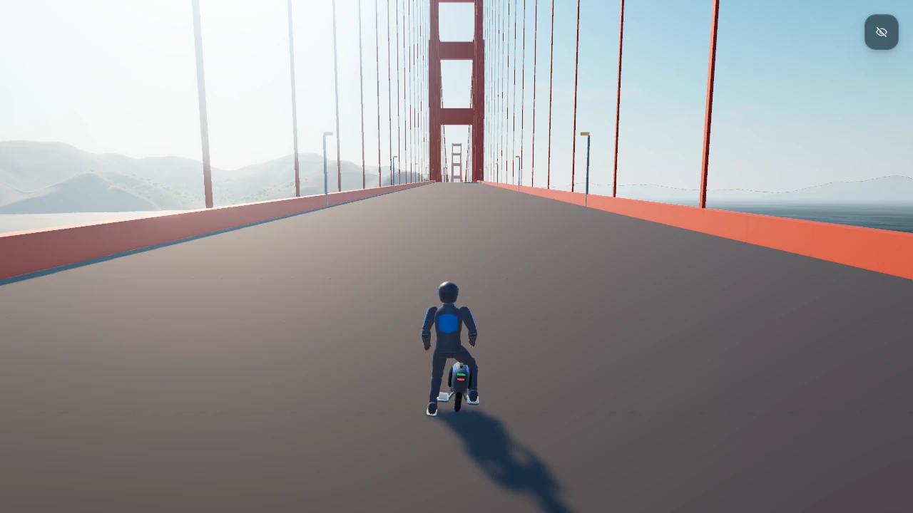
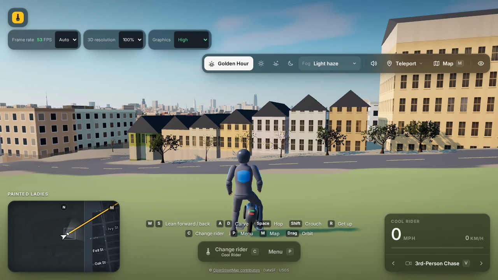
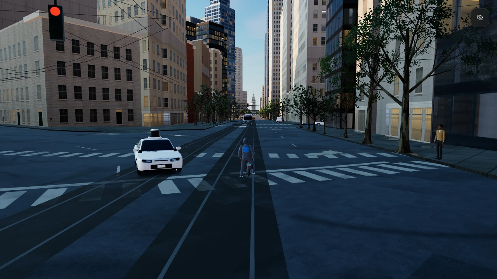
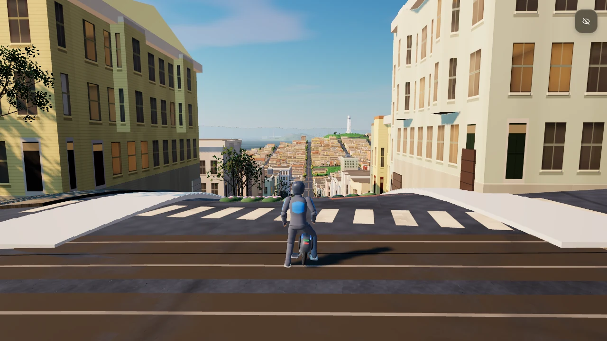
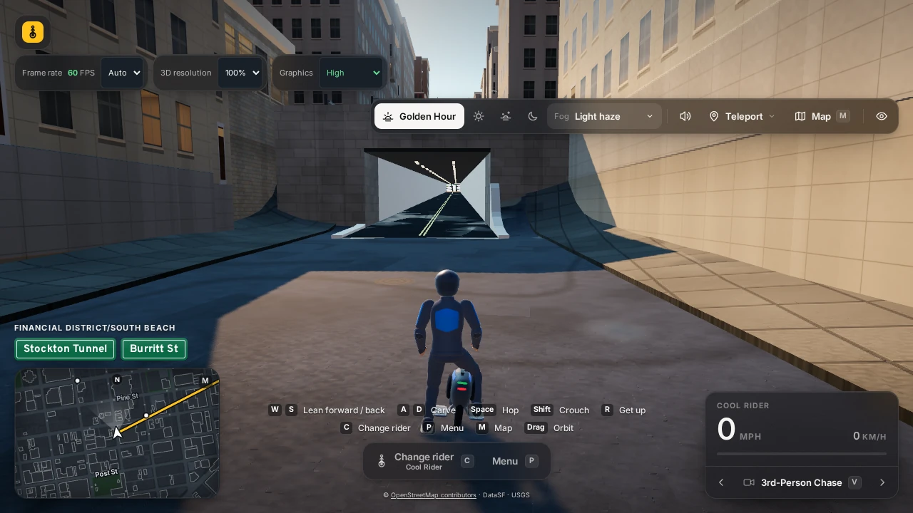

# SF Spin-off: EUC Thrills — Early Access / Work in Progress

> **Early Access / Work in Progress.** Every destination can be reached and ridden, and the game runs with both
> WebGPU and WebGL2. Expect rough visuals, a long first load and unfinished corners; see
> [Known rough spots](#known-rough-spots). Feedback is very welcome.

**[▶ Play now](https://vibezzzcoder.github.io/euc-sanfrancisco/)**

**[EUC Thrills website](https://euc.erodmen.com/)**

Ride an electric unicycle through a living 3D San Francisco. Climb the real hills, roll down to the waterfront,
cross the Golden Gate and explore Twin Peaks and the Painted Ladies. Buildings, traffic, pedestrians, cable cars,
trams and fog share the streets. This is a free, separately hosted city destination in
[*EUC Thrills*](https://github.com/VibezZzCoder/EUC-thrills) by VibezZzCoder, requested by Maribel Vargas.

The riding comes from *EUC Thrills*: the wheel's physics, the riders and the crashes. The city is adapted from
[Kamil's Slop San Francisco](https://github.com/unable12/slop-sanfrancisco), itself derived from
[Mr.doob's Slop New York](https://github.com/mrdoob/slop-newyork), both MIT. It is not meant to merge back.

Exploration comes first. There is no score: roam, find a route and enjoy the city. The steep grades are real and
intentional, so leave room to brake on descents. Simple tricks are optional extras.

Choose from eleven reviewed riders: **Cool Rider, Trollina, Red Rider, Adonisb2, Maribel Vargas, Wheel in Motion,
The Drunkard, FloWithZo, Seal on a Wheel, Wyldist and Gnarwheel**. Each has their own look, wheel and mapped crash
sounds. Browse profiles, then confirm a rider; browsing does not load the whole roster. City brands are fictional or
generic. Reviewed participant marks, including Wyldist's separately owned SMLS sleeve mark, are the narrow
owner-approved exception. Street, district and landmark names are kept as place names. See the
[rights notice](NOTICE-EUC-THRILLS.md).

<p align="center">
  <a href="screenshots/golden-gate.webp"></a>
  <a href="screenshots/painted-ladies.webp"></a>
</p>
<p align="center">
  <a href="screenshots/market-street.webp"></a>
  <a href="screenshots/lombard-coit.webp"></a>
</p>
<p align="center">
  <a href="screenshots/stockton-tunnel.webp"></a>
</p>

*In-game screenshots from the Early Access build: WebGPU, High graphics, 100% 3D resolution, Golden Hour,
1280×720. Three views use the game's hide-HUD control. Click any image for full size.*

## Play

Open the [play link](https://vibezzzcoder.github.io/euc-sanfrancisco/) in an up-to-date desktop browser with hardware
acceleration. WebGPU is preferred; the renderer falls back to WebGL2 automatically when WebGPU is unavailable.
The first load downloads and builds a large city, so allow about **30 seconds on a desktop** (longer on slower
machines or connections). Choose a rider if you like, then press **Ride**. Sound starts after your first interaction.

Use the map (`M`) to find places and jump to them. A map pin marks a place; an arrival is only accepted when there
is a safe spot to stand.

The title link and the pause menu's confirmed return action go back to the
[EUC Thrills main menu](https://vibezzzcoder.github.io/EUC-thrills/) in the same tab.

### Controls

| | Keyboard and mouse | Gamepad (Xbox layout) |
|---|---|---|
| Accelerate / brake, then reverse | `W` / `S` or `↑` / `↓` | RT / LT, or left stick |
| Steer | `A` / `D` or `←` / `→` | Left stick |
| Hop (kerbs!) | `Space` | A |
| Charge / tuck | `Shift` | X |
| Get up after a crash | `R` | B |
| Camera | `V` / `Shift+V` cycle forward / backward; mouse drag orbits, wheel zooms | Y; right stick orbits |
| Map | `M` | Start |
| Pause / menu | `Escape` or `P` | View / Back |
| Rider picker | `C` | LB / RB |
| Hide HUD / toggle sound | `H` / `N` | |

**Touch (phones and tablets, portrait and landscape):** the floating left stick steers and controls throttle and
braking; **HOP**, **CHARGE** and **GET UP** sit on the right. Drag outside the controls to orbit the camera and
pinch to zoom. Rotating, folding or resizing releases held gestures: lift and touch again.

The upper-left **3D resolution** (100/75/50%) and **Graphics** (High/Medium/Low) controls reduce rendering cost;
**Frame rate** sets a rendering cap, with Auto following your display. They change rendering only;
routes, physics, traffic and the city stay the same. The speedometer
shows mph and km/h. The [player guide](PLAYER_GUIDE.md) covers every control, the map, recovery and settings.

## Skateparks

- **UN Skate Plaza:** an 18×104 m Jefferson-inspired plaza with 11 features, linked banks and rollers, tabletop,
  manual pad, bench, rail and opposing curved quarters for back-and-forth riding. A 4 m central strip stays clear.
- **Zion / Waller Street:** a 38×76 m Pier 62-inspired park on the grass beside Waller, with 9 features, broad flow
  lines, an 8 m-wide opposing halfpipe and a quarter/deck with a banked return. The road stays open beside its access path.
- Use **Teleport**, or search the map for **UN Plaza**, **United Nations**, **Zion** or **Waller**. Skateboard icons
  identify both parks on the fullscreen map and minimap. Arrivals are checked for a safe standing spot and ride-away.
- The parks use original gameplay layouts adapted from the NYC destination, not surveyed replicas. Enter halfpipes
  at moderate speed and ease off before the curved faces; full throttle can carry you over a lip. See the
  [skatepark riding guide](PLAYER_GUIDE.md#skatepark-riding) and [source provenance](provenance/nyc-skateparks.json).

## Known rough spots

This is an early release. Known issues include:

- **Tunnel approaches:** some approach ramps sit awkwardly behind the newer tunnel portal walls.
- **Bay Bridge:** upper-west traffic may extend beyond the visible deck.
- **Outer neighbourhoods** look bland and low in detail.
- **Union Square, Dragon Gate and Fisherman's Wharf** still lack their real character.
- **Alcatraz and Yerba Buena Island** are undercooked.
- **Golden Gate Park** has sparse trees.
- **Long first load:** around 30 seconds on a desktop, longer on slower devices.
- **Phones, tablets and foldables:** touch layouts are tested in desktop browser emulation, but physical phones and
  foldables are not fully verified. Performance on phones may be low; the 3D resolution and Graphics options can help.

## Feedback

Please report bugs and ideas through
[GitHub Issues](https://github.com/VibezZzCoder/euc-sanfrancisco/issues), also available from the pause menu's
**Feedback / bugs** link. The pause menu's **Player guide** opens this repository's guide; both links open a new tab
and keep SF paused. Helpful details: where you were (street
or destination), the rider, your device, browser and graphics card, the graphics backend shown on screen if any,
your Frame rate / 3D resolution / Graphics settings, the input device and the steps that led to the problem.
Please say whether you used a physical phone or tablet, a foldable or a desktop browser. See also
[CONTRIBUTING.md](CONTRIBUTING.md).

## Run it locally

No build step and no install. Use Node.js 24 or newer:

```bash
node tools/serve.mjs
# then open http://127.0.0.1:8002
```

The preview binds only to your own machine and serves the game files. Stop it with **Ctrl+C**.

## Developing

- `node --test tests/*.test.*` runs the headless tests (Node.js 24).
- `node tools/build-static.mjs` then `node tools/check-static.mjs` builds and checks the runtime file set in
  `dist/`; `node tools/serve.mjs --dist` previews it.
- City data is delivered as lossless gzip copies (`data/**/*.bin.gz`); `node tools/compress-data.mjs --check`
  confirms each one inflates to the exact committed `.bin` beside it. The raw files stay in the repository as the
  test and source-of-truth form of the database.
- `js/euc/` is generated; do not edit it. The base is EUC Thrills v1.1.0
  `5f45fff19b258e140833841ba2473069af751a12`, with six reviewed code files from
  `d37efc07cddc0d76ff7aa585901710d357b8e5a1` (v1.4.0). With clean local checkouts of both:

  ```bash
  node tools/vendor-euc.mjs --src ../EUC-thrills --donor ../EUC-thrills-latest --check
  ```

- three.js (one pinned commit) and the Inter and Overpass fonts are kept in the repository (`vendor/three/`,
  `fonts/`), so the game loads only from its own host. `node tools/vendor-three.mjs --check` confirms them.
- The offline geography tools and queries under `tools/` are kept for provenance and reproducibility. The game does
  not need them: the generated data is already included.
- Source identities and provenance: [provenance/README.md](provenance/README.md).

### Fork authors and coding agents

**[Read the public fork guide](FORK_GUIDE.md)** before repurposing the roster. Independently branded forks with
original characters are encouraged. MIT code and CC BY original assets have no EUC Thrills branding condition;
real identities, supplied logos, contributed recordings and SMLS have separate rights. For an independent game,
replace identity-bearing material unless separately permitted. Hiding chooser entries or renaming riders is not
removal: trace imports, embedded payloads, audio and actual distributed output. Keeping the name grants no rights.

## License and data

- Code: [MIT License](LICENSE). The city: © 2026 Mr.doob (Slop New York) and © 2026 Kamil
  ([@unable0_](https://x.com/unable0_)) for the San Francisco contributions. Keep the copyright lines in every copy.
- *EUC Thrills* code: MIT, © 2026 VibezZzCoder ([js/euc/LICENSE](js/euc/LICENSE)). Original rider/wheel asset work:
  CC BY 4.0, **excluding real identities and the supplied/third-party material identified in the notice**.
  Assets from *EUC Thrills* by VibezZzCoder — CC BY 4.0 — https://github.com/VibezZzCoder/EUC-thrills. See
  [NOTICE-EUC-THRILLS.md](NOTICE-EUC-THRILLS.md), which must travel with every copy. Audio files and their licences
  are listed in [audio/euc/PROVENANCE.md](audio/euc/PROVENANCE.md); contributed recordings and generated vocal layers
  have their own terms there.
- San Francisco geographic data: **City and County of San Francisco / DataSF** (PDDL; Land Use CC0),
  **USGS 3D Elevation Program** (public domain) and
  **© [OpenStreetMap contributors](https://www.openstreetmap.org/copyright)** under the
  [Open Database License (ODbL 1.0)](https://opendatacommons.org/licenses/odbl/1-0/). The OpenStreetMap-derived
  parts of the generated city data are a derivative database under the ODbL and stay openly available in this
  repository, both as the raw `.bin` files and as their lossless `.bin.gz` delivery copies. Credits are also shown
  in the game. Sources and transformations: [provenance/data-sources.md](provenance/data-sources.md) and
  [provenance/formats.md](provenance/formats.md); landmark references:
  [provenance/landmarks/INDEX.md](provenance/landmarks/INDEX.md).
- three.js: MIT ([vendor/three/LICENSE](vendor/three/LICENSE)). Inter and Overpass: SIL Open Font License 1.1
  ([fonts/OFL-Inter.txt](fonts/OFL-Inter.txt), [fonts/OFL-Overpass.txt](fonts/OFL-Overpass.txt)).
- Full map of materials and licences: [LICENSING.md](LICENSING.md) · city and data notice: [NOTICE.md](NOTICE.md).

This project is not affiliated with or endorsed by Mr.doob, Kamil, any rider, the City and County of San Francisco,
or any manufacturer or brand. This is a game, not real-world EUC riding instruction.
